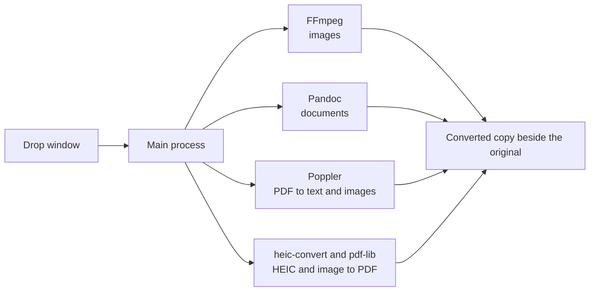

# SwiftConvertor

**Drag. Drop. Done. Your files never leave your PC.**


SwiftConvertor is an offline file converter for Windows. Drag a file onto a small floating circle, pick a format from the wheel that opens, drop it, and the converted copy appears next to the original. No uploads, no account, no internet.

## Demo

<!--
ADD YOUR SCREEN RECORDING HERE. Pick one:

Option 1 (GIF, plays inline): save it as docs/demo.gif and keep the line below.
Option 2 (video): on GitHub, edit this README, drag your .mp4 into the editor, and GitHub inserts a playable link. Paste it here.
Option 3 (YouTube or Drive): replace YOUR_VIDEO_LINK below.
-->


### Conversions shown in the demo

<!-- Replace each placeholder with a screenshot or short GIF from your recording. Delete any you do not use. -->

| PNG to JPG | DOCX to PDF |
|---|---|
|  |  |

| MD to DOCX | PDF to PNG |
|---|---|
|  |  |

## Screenshots

<!-- Save your screenshots in docs/screenshots/ with these names, or change the paths below. -->

| Idle | Wheel open | File over a format |
|---|---|---|
|  |  |  |

## Why SwiftConvertor

Online converters upload your private files, show ads, limit file sizes and need internet. SwiftConvertor does the conversion on your own PC with bundled tools, so documents, photos and PDFs never leave it.

## Features

**Images**
- Convert between JPG, PNG, WebP, BMP and TIFF, and read iPhone HEIC photos.
- Turn any image into a PDF (one PDF per image).
- Transparent areas become white when saving to JPG or BMP.

**Documents**
- Convert between DOCX, Markdown and plain text.
- Export DOCX, Markdown or text to a clean A4 PDF with page numbers.
- Text files with accents or non-English letters keep their characters.

**PDF**
- Extract text from a PDF to TXT.
- Turn each page into a PNG or JPG, saved in a new folder.

**Batch and quality**
- Drop many files at once. Files already in the chosen format are skipped, and one failure never stops the rest.
- Right-click the circle to choose a quality preset: Small, Balanced or Best. It controls JPG and WebP quality and the resolution of PDF pages turned into images (100, 150 or 300 DPI).

**Safe output**
- The original is never changed or overwritten.
- Results are saved beside the original as `name(format).format`, for example `signature.jpg` converted to PNG becomes `signature(png).png`. If that name exists, a counter is added: `signature(png) (2).png`.
- A Show in folder button appears when a conversion finishes.

## Supported formats

| Kind | Input | Output |
|---|---|---|
| Images | JPG, PNG, WebP, BMP, TIFF, HEIC | JPG, PNG, WebP, BMP, TIFF, PDF |
| Documents | DOCX, MD, TXT | DOCX, MD, TXT, PDF |
| PDF | PDF | TXT, PNG, JPG |

## Install

1. Download `SwiftConvertor-Setup-1.0.0.exe` from the [Releases page](https://github.com/YOUR-USERNAME/SwiftConvertor/releases).
2. Double-click it. If Windows shows "Unknown publisher", click **More info**, then **Run anyway** (the installer is not code-signed yet).
3. The app installs for your user account, so no administrator rights are needed. It opens when the install finishes and adds a desktop shortcut.
4. To uninstall, go to **Settings > Apps > SwiftConvertor > Uninstall**.

## How to use

1. Drag one or more files onto the floating circle.
2. The circle grows into a wheel of valid formats. Drop the files on the format you want.
3. The converted files appear next to the originals. Click **Show in folder** to open them.
4. Right-click the circle for the quality presets or to quit.

## How it works



The window never touches your files directly. It sends requests to the main process, which checks every request and runs the bundled converters. Everything runs locally and the app makes no network calls.

## Build from source

**Prerequisites:** Windows 10 or 11, [Node.js](https://nodejs.org) LTS and [Git](https://git-scm.com). To build the installer, turn on Windows Developer Mode.

```
git clone https://github.com/YOUR-USERNAME/SwiftConvertor.git
cd SwiftConvertor
npm install
```

The converter programs are not stored in Git because of their size. Download them and place them like this:

```
bin/
  ffmpeg.exe         from https://www.gyan.dev/ffmpeg/builds/
  pandoc.exe         from https://pandoc.org/installing.html
  poppler/           from https://github.com/oschwartz10612/poppler-windows/releases
                     (copy the contents of Library\bin here, plus the license files)
```

| Command | What it does |
|---|---|
| `npm start` | Run the app in development |
| `npm run selftest` | Run real conversions of every supported type and report pass or fail |
| `npm run pack` | Build an unpacked app folder in `dist\win-unpacked` |
| `npm run icon` | Generate the app icon files from `build/icon-source.png` |
| `npm run dist` | Build the Windows installer in `dist` |

## Project structure

```
SwiftConvertor/
  bin/             ffmpeg, pandoc and poppler (not stored in Git)
  build/           app icon files
  scripts/         icon generator and converter tests
  src/main/        Electron main process: window, IPC, settings
  src/renderer/    drop zone, wheel and finish screens (HTML, CSS, JavaScript)
  src/converters/  image, document, PDF and HEIC conversion code
  package.json     scripts and installer settings
```

## Testing

`npm run selftest` converts sample files of every supported type with the same code the app uses and writes a pass or fail report. Run the packaged build with `dist\win-unpacked\SwiftConvertor.exe --self-test` to confirm everything also works from the installed layout.

## Known limitations

- Windows only.
- The installer is not code-signed, so Windows shows an "Unknown publisher" warning.
- Complex Word layouts look approximate in a PDF.
- Scanned PDFs have no text to extract.
- The app works from a drop window. Dragging from anywhere on the screen is not supported.
- PPTX, Pages, audio and video are not supported yet.

## Roadmap

- Audio and video conversion
- ZIP and unzip in both directions
- Compression for images and PDFs
- Editing tools: crop, resize, merge and split PDFs
- Metadata editor
- PPTX and Pages support, and PDF to DOCX
- Explorer right-click menu and a keyboard shortcut

## Credits and licenses

Inspired by [Tangerine](https://tangerineformac.com) for Mac and [Filee](https://filee.sh) for Windows.
Powered by Electron, FFmpeg, Pandoc, Poppler, heic-convert and pdf-lib. The bundled tools keep their own licenses, and their license files ship with the app.

License for this project: add your chosen license here (for example MIT).

## Author

Yash
